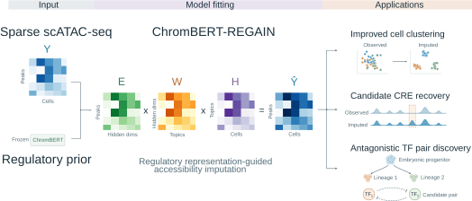

# ChromBERT-REGAIN



Sparse **scATAC-seq** accessibility imputation with a **fixed ChromBERT region embedding** $E$:

$\[
Y \approx E W H
\]$

This repository ships the **core method** (ALS imputation), peak→bin indexing, and a **tiny demo** that runs without downloading the full genome-wide embedding.

> Paper figure reproduction is out of scope here. Use this repo to impute your own peak × cell matrix.

---

## Repository layout

```
ChromBERT-REGAIN/
├── regain/                      # core model
│   ├── impute_als.py            # production ALS (recommended)
│   └── impute_als_ablation.py   # real / random / shuffled E
├── scripts/
│   ├── run_impute.sh
│   ├── download_embeddings.sh   # Hugging Face → local zarr
│   ├── prepare_peak_indices.py  # peak → ChromBERT bin index
│   └── evaluate_clustering.py
├── configs/default_impute.yaml
├── annotations/                 # ChromBERT bin BEDs (hg38 / mm10)
├── examples/
│   ├── demo/                    # tiny offline smoke-test (recommended first run)
│   └── minimal_usage.md         # full-data workflow
└── docs/
    ├── ChromBERT-REGAIN_Fig1a.svg
    ├── model.md
    └── embedding.md
```

---

## 1. Install

```bash
git clone https://github.com/llzzhh0512/ChromBERT-REGAIN.git
cd ChromBERT-REGAIN

conda create -n regain python=3.10 -y
conda activate regain
pip install -r requirements.txt --only-binary=:all:

# needed only when mapping peaks → ChromBERT bins on your own data
conda install -c bioconda bedtools -y   # or: sudo apt install bedtools
```

---

## 2. Quick start (demo, no large download)

A toy subset (~200 cells × 3000 peaks + matching mini embedding, a few MB) is under `examples/demo/`:

```bash
bash examples/demo/run_demo.sh
```

Output: `examples/demo/output/demo_imputed.h5ad`

| Field | Meaning |
|-------|---------|
| `adata.X` | Imputed relative accessibility (float16; **can be negative**) |
| `adata.obsm['latent']` | Cell factors $H^\top$ (cells × $K$) |
| `adata.varm['topic']` | Peak factors $Z = E W$ (peaks × $K$) |
| `adata.uns['ALS_A']` | Factor $W$ ($L$ × $K$) |

Details: [`examples/demo/README.md`](examples/demo/README.md).

---

## 3. Full workflow (your data + genome-wide $E$)

### 3.1 Download ChromBERT region embeddings

Genome-wide embeddings are hosted on Hugging Face:

**https://huggingface.co/datasets/llzzhh0512/ChromBERT-REGAIN**

Currently published:

| File | Genome | Notes |
|------|--------|--------|
| `atac_embs_dim.tar` | hg38 | ~9.5 GB; extract to `atac_embs_dim.zarr/` |
| `atac_embs_dim_mm10.tar` | mm10 | ~4.5 GB; extract to `atac_embs_dim_mm10.zarr/` |

```bash
# downloads both into ./embeddings/ (override with DEST=... or GENOME=hg38|mm10)
bash scripts/download_embeddings.sh
```

Or manually:

```bash
pip install -U "huggingface_hub[cli]"
# hg38
huggingface-cli download llzzhh0512/ChromBERT-REGAIN atac_embs_dim.tar \
  --repo-type dataset --local-dir embeddings
mkdir -p embeddings/atac_embs_dim.zarr
tar -xf embeddings/atac_embs_dim.tar -C embeddings/atac_embs_dim.zarr
# mm10
huggingface-cli download llzzhh0512/ChromBERT-REGAIN atac_embs_dim_mm10.tar \
  --repo-type dataset --local-dir embeddings
mkdir -p embeddings/atac_embs_dim_mm10.zarr
tar -xf embeddings/atac_embs_dim_mm10.tar -C embeddings/atac_embs_dim_mm10.zarr
# expect: embeddings/atac_embs_dim*.zarr/full  (and optional PCA/)
```

See [`docs/embedding.md`](docs/embedding.md) for array layout (`full` = 768-d; optional `PCA/<dim>`).

### 3.2 Prepare input `.h5ad`

Cells × peaks matrix with:

- `adata.X` — sparse/dense counts (or binary)
- `adata.varm['indices']` — integer ChromBERT **bin index** per peak

Ship bin BEDs:

| Genome | BED |
|--------|-----|
| hg38 | `annotations/hg38_6k_1kb_region.bed` |
| mm10 | `annotations/mm10_5k_1kb_region.bed` |

```bash
python scripts/prepare_peak_indices.py \
  --input  data/raw_peaks.h5ad \
  --bins   annotations/hg38_6k_1kb_region.bed \
  --output data/peaks_indexed.h5ad \
  --drop-unmapped
```

Peak names must be parseable as `chr:start-end` (e.g. `chr1:100-200`).

### 3.3 Run imputation

```bash
export EMB_DIR=embeddings/atac_embs_dim.zarr   # extracted HF archive (hg38)
# export EMB_DIR=embeddings/atac_embs_dim_mm10.zarr   # mm10
export INPUT=data/peaks_indexed.h5ad
export OUTPUT=output/peaks_imputed_ALS.h5ad

bash scripts/run_impute.sh
```

Equivalent one-liner:

```bash
python -u regain/impute_als.py \
  --input  data/peaks_indexed.h5ad \
  --output output/peaks_imputed_ALS.h5ad \
  --emb_dir embeddings/atac_embs_dim.zarr \
  --emb_dim 768 \
  --topics 128 \
  --lambdaA 1 \
  --lambdaB 0.1 \
  --als_iters 20 \
  --cg_iters 500 \
  --binary \
  --seed 42
```

Default hyperparameters match the main benchmarks (`configs/default_impute.yaml`).

### 3.4 Load results

```python
import scanpy as sc
ad = sc.read_h5ad("output/peaks_imputed_ALS.h5ad")
X = ad.X                 # imputed scores
H = ad.obsm["latent"]    # cells × K  (H^T in Y ≈ E W H)
Z = ad.varm["topic"]     # peaks × K  (= E W)
W = ad.uns["ALS_A"]      # L × K
```

Unseen-peak extrapolation (after fitting on training peaks):

```python
# E_test: (P_test, L) rows from the same ChromBERT zarr
imputed_test = (E_test @ W @ H.T).T   # cells × test_peaks
```

More notes: [`docs/model.md`](docs/model.md) · [`examples/minimal_usage.md`](examples/minimal_usage.md).

---

## Citation

- **ChromBERT-REGAIN** — fixed region embedding $E$ + ALS low-rank reconstruction for scATAC-seq imputation  
- Region embeddings are ChromBERT pretrained artifacts (regulatory-factor ChIP-seq co-association; not a sequence-only LM)

---

## License / data

- Code: see repository license  
- Demo matrix: small public T-cell ATAC subset for smoke-testing only  
- Full embeddings: [Hugging Face dataset](https://huggingface.co/datasets/llzzhh0512/ChromBERT-REGAIN)
